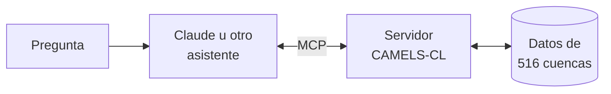

# MCP de CAMELS-CL

Servidor [MCP](https://modelcontextprotocol.io) (Model Context Protocol) que facilita la consulta de la base
**CAMELS-CL** de 516 cuencas de Chile desde un asistente de IA (Claude u otro cliente MCP), haciendo las
preguntas en lenguaje natural. Es una herramienta gratuita y sin fines comerciales.

CAMELS-CL fue desarrollada por Alvarez-Garreton et al. (2018) y se describe en
[Hydrology and Earth System Sciences, 22, 5817-5849](https://hess.copernicus.org/articles/22/5817/2018/).
Este servidor usa la versión v202201.

## Cómo usarlo

Agregar esta dirección como conector personalizado en cualquier cliente MCP que admita servidores remotos.
No requiere cuenta, clave ni instalación.

```
https://mcp-camels-cl.mcp-camels-cl.workers.dev/mcp
```

## Qué se puede consultar

- Búsqueda de cuencas por nombre, ubicación o atributos, y ficha completa de cada una (111 atributos).
- Series diarias, mensuales o anuales de caudal (1913 a 2020), precipitación (CR2MET, MSWEP, CHIRPS y
  TMPA), temperatura, evapotranspiración potencial y derechos consuntivos de agua.
- Estadísticas: régimen mensual, valores anuales, curva de duración y extremos anuales de caudal.
- Comparación de atributos entre cuencas.

Cada respuesta indica unidades, porcentaje de datos faltantes y la cita de la fuente.

Algunos ejemplos de preguntas:

- ¿Cuál es el Q90 del río Aconcagua en Chacabuquito?
- Muestra la precipitación anual de la cuenca del Maipo en San Alfonso entre 2000 y 2019.
- ¿Qué cuencas nivales hay a menos de 100 km de Santiago?

## Cómo funciona



## Calidad y seguridad

Cada cambio pasa por pruebas automáticas y análisis de seguridad antes de publicarse, se prueba en una
versión de vista previa y llega a producción solo con aprobación manual. El servicio se verifica a diario.
El detalle y la forma de reportar vulnerabilidades están en [SECURITY.md](SECURITY.md).

## Cita

Al usar estos datos, citar el artículo original:

Alvarez-Garreton, C., Mendoza, P. A., Boisier, J. P., Addor, N., Galleguillos, M., Zambrano-Bigiarini, M.,
Lara, A., Puelma, C., Cortes, G., Garreaud, R., McPhee, J. y Ayala, A. (2018). The CAMELS-CL dataset:
catchment attributes and meteorology for large sample studies, Chile dataset. *Hydrology and Earth System
Sciences*, 22, 5817-5849. https://hess.copernicus.org/articles/22/5817/2018/

## Licencia y autoría

El código se distribuye bajo la licencia [GNU GPL v3](LICENSE) o posterior. Los datos de CAMELS-CL
pertenecen a sus autores y se distribuyen con licencia
[CC BY 4.0](https://creativecommons.org/licenses/by/4.0/).

Servidor desarrollado por Diego Herrera Pino.
